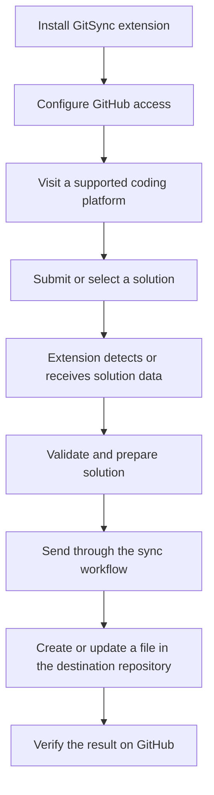

# 🚀 GitSync — Your Coding Journey, Automatically Synced

<p align="center">
  <strong>Code. Solve. Sync. Build your developer portfolio.</strong>
  <br />
  Automatically sync and organize coding solutions on GitHub.
</p>

<p align="center">
  <a href="https://github.com/Vatsasarthak/GitSync">
    
  </a>
  <a href="https://github.com/Vatsasarthak/GitSync/network/members">
    
  </a>
  <a href="https://github.com/Vatsasarthak/GitSync/issues">
    
  </a>
  <a href="LICENSE">
    
  </a>
</p>

<p align="center">
  <a href="#-overview">Overview</a> •
  <a href="#-features">Features</a> •
  <a href="#proof-of-work">Proof of Work</a> •
  <a href="#how-it-works">How It Works</a> •
  <a href="#-installation">Installation</a> •
  <a href="#roadmap">Roadmap</a> •
  <a href="#-contributing">Contributing</a>
</p>

---

## 💡 Overview

**GitSync** is a coding-solution synchronization project designed to help developers organize their programming practice on GitHub without repetitive manual copying and committing.

Developers solve problems across platforms such as LeetCode, GeeksforGeeks, CodeChef, Codeforces, and HackerRank. GitSync aims to streamline the process of collecting coding solutions and maintaining an organized developer portfolio.

### 🎯 The Problem

- Coding solutions are scattered across multiple platforms.
- Manually uploading solutions takes time.
- Maintaining a consistent repository structure is difficult.
- GitHub portfolios may not reflect ongoing coding practice.

### ✨ The Solution

GitSync connects coding practice with GitHub through a solution synchronization workflow.

**Solve problems. Sync your solutions. Keep your coding portfolio organized.**

## ✨ Features

| Feature | Description |
|---|---|
| 🔄 Solution Synchronization | Sync coding solutions to GitHub through the available workflow. |
| 🌐 Multi-Platform Support | Designed for popular coding platforms. |
| 📁 Organized Solutions | Keep problem records organized in a structured repository. |
| ♻️ Duplicate Prevention | Avoid duplicate files where supported by the implementation. |
| 🔁 Retry Handling | Retry failed synchronization operations where implemented. |
| 🖱️ Manual Sync | Initiate synchronization manually where supported. |
| 📌 Problem Metadata | Preserve relevant problem information and metadata where available. |

*Feature availability depends on the current implementation. Refer to the source code and issues for the latest status.*

---

<a id="proof-of-work"></a>
## ✅ Proof of Work — GitSync in Action

GitSync's destination repository contains solution records with commits explicitly labelled as GitSync-generated. You can inspect the commit message, changed files, and resulting problem record directly on GitHub.

### Live Repositories

- **Extension Source:** [Vatsasarthak/GitSync](https://github.com/Vatsasarthak/GitSync)
- **Destination Repository:** [Vatsasarthak/Data-Structures-and-Algorithms](https://github.com/Vatsasarthak/Data-Structures-and-Algorithms)
- **Destination Commit History:** [View all commits](https://github.com/Vatsasarthak/Data-Structures-and-Algorithms/commits/main/)

### Example Commits

| Example | What You Can Verify |
|---|---|
| [Contains Duplicate II — LeetCode](https://github.com/Vatsasarthak/Data-Structures-and-Algorithms/commit/a1c0ca913461766cd8ee908af33e5713651fe6e9) | Inspect the commit message and added problem record. |
| [Sum of Squares of Special Elements — LeetCode](https://github.com/Vatsasarthak/Data-Structures-and-Algorithms/commit/4df89f17ecbe93aef3d6b8d68f290aeae343916f) | Inspect another problem record and its changed files. |
| [Maximum Depth of Binary Tree — LeetCode](https://github.com/Vatsasarthak/Data-Structures-and-Algorithms/commit/c32c925cb4e68d1a251b865446edee9b367db4d2) | Inspect a further example in the destination repository. |

These links demonstrate that GitHub contains commits labelled as GitSync output. They are evidence of destination-repository changes, not proof that every supported platform or every current build works end to end.

### Reproduce a Sync

1. Follow the setup instructions in this README and [GitHub OAuth Setup](GITHUB_OAUTH_SETUP.md).
2. Load the unpacked extension from the directory containing `manifest.json` in `chrome://extensions/`.
3. Complete the configured GitHub authentication and destination-repository setup.
4. Use a coding platform and submission flow supported by the current implementation.
5. Check the extension's visible status or logs for the sync result.
6. Open the destination repository and confirm the expected file and commit were created or updated.

If the sync fails, capture the browser extension error and relevant non-sensitive logs, then check [Troubleshooting](#-troubleshooting). Never share OAuth secrets, tokens, or `.env` values.

---

## 🌐 Supported Platforms

GitSync is designed around the following coding platforms.

| Platform | Website |
|---|---|
| LeetCode | [Visit Website](https://leetcode.com/) |
| GeeksforGeeks | [Visit Website](https://www.geeksforgeeks.org/) |
| CodeChef | [Visit Website](https://www.codechef.com/) |
| Codeforces | [Visit Website](https://codeforces.com/) |
| HackerRank | [Visit Website](https://www.hackerrank.com/) |

Check the current source code to confirm which integrations are operational in your version.

<a id="how-it-works"></a>
## ⚙️ How It Works

The intended user journey is shown below. The exact platform-detection and message-handling details are implemented in the extension source; consult those files when debugging a specific platform.



### What to Check When a Sync Fails

- **Detection:** Confirm that the platform is supported by the current source code and that its content script or detection handler is running.
- **Authentication:** Confirm GitHub authorization is configured and has the required repository access.
- **Processing and Queue:** Inspect the extension/service-worker logs and queue state where these are available in the current implementation.
- **Upload:** Check the GitHub API response, destination repository, file path, and rate-limit/error messages.
- **Verification:** Confirm the expected file appears in the destination repository and inspect the resulting commit.

This diagram describes the workflow at a high level. It does not guarantee that every integration or failure-recovery path has been verified on every platform. See [Troubleshooting](#-troubleshooting) and inspect the source for implementation-specific behavior.

## 📂 Example Repository Structure

GitSync aims to keep coding solutions organized in a structured repository.

```text
Data-Structures-and-Algorithms/
├── LeetCode/
│   ├── Easy/
│   ├── Medium/
│   └── Hard/
├── GeeksforGeeks/
├── CodeChef/
├── Codeforces/
└── HackerRank/
```

*Illustrative structure. The actual destination repository may use a different directory layout.*

## 🛠️ Technology Stack

GitSync is designed around browser-extension and GitHub integration workflows.

| Component | Technology / Purpose |
|---|---|
| Browser Extension | Chrome Extension / Manifest V3 |
| GitHub Integration | GitHub API |
| Authentication | GitHub authorization flow, if implemented |
| User Interface | Browser extension interface |
| Local State | Browser storage or configured persistence |
| Synchronization | Solution processing and repository updates |

Refer to the source code for the definitive list of frameworks, libraries, and services.

## 🚀 Installation

### Prerequisites

- Google Chrome or a compatible Chromium browser.
- Git, if you prefer cloning the repository.
- A GitHub account with access to a destination repository.

### Option 1: Clone the Repository

```bash
git clone https://github.com/Vatsasarthak/GitSync.git
cd GitSync
```

### Option 2: Download ZIP

1. Visit the [GitSync repository](https://github.com/Vatsasarthak/GitSync).
2. Click **Code → Download ZIP**.
3. Extract the downloaded archive.
4. Locate the browser extension directory.

### Load the Extension in Chrome

1. Open `chrome://extensions/`.
2. Enable **Developer mode**.
3. Click **Load unpacked**.
4. Select the directory containing `manifest.json`.
5. Confirm that GitSync appears in the extensions list.
6. Follow the setup and authentication instructions provided by the implementation.

> Select the directory containing `manifest.json`, not necessarily the repository root.

### Configure GitHub

Complete any required authentication, repository selection, and configuration steps specified in the source code.

Never commit private access tokens, OAuth secrets, or credentials to GitHub.

## 📸 Screenshots

### Dashboard

<p align="center">
  
</p>

### Synchronization Success

GitSync is intended to sync coding solutions to GitHub through the supported coding workflow.


### Destination Repository


If an image does not render, verify that the file exists under `assets/` and that the filename capitalization matches.

<a id="roadmap"></a>
## 🗺️ Roadmap

The roadmap below lists **future improvements**, not claims about current functionality. Existing capabilities should be checked against the source code and reproducible evidence above.

### Planned

- [ ] Add a coding analytics dashboard with solution counts and platform breakdowns.
- [ ] Add a daily streak tracker based on verified sync history.
- [ ] Explore contest rating and participation tracking where supported APIs permit it.
- [ ] Build a smart revision planner from saved problem metadata.
- [ ] Explore a VS Code integration.
- [ ] Explore a mobile companion experience.
- [ ] Improve problem tagging and metadata consistency across platforms.
- [ ] Add collaborative destination-repository workflows.
- [ ] Expand automated browser-level and end-to-end tests for each supported platform.
- [ ] Improve rate-limit backpressure, diagnostics, and recovery from transient API failures where gaps remain.

Items will be marked complete only after implementation and verification. Have a suggestion? [Open an issue](https://github.com/Vatsasarthak/GitSync/issues).

## 🔒 Privacy and Security

Security matters when working with coding platforms and GitHub repositories.

- Never commit credentials or access tokens.
- Request only the permissions required by the application.
- Protect sensitive configuration and environment variables.
- Review which data is stored locally or transmitted.
- Verify token storage and authentication behavior in the implementation.
- Report security vulnerabilities responsibly.

Consult the source code and relevant security documentation for implementation-specific details.

## 🤝 Contributing

Contributions are welcome! Help improve GitSync through bug fixes, platform integrations, testing, documentation, and UI/UX improvements.

### Contribution Workflow

1. Fork the repository.
2. Clone your fork.
3. Create a feature branch.
4. Implement and test your changes.
5. Commit with a meaningful message.
6. Push your branch.
7. Open a pull request.

```bash
git clone https://github.com/Vatsasarthak/GitSync.git
cd GitSync

git checkout -b feature/your-feature
git add .
git commit -m "feat: describe your change"

git push origin feature/your-feature
```

### Areas for Contribution

- 🐛 Bug fixes and error handling
- 🌐 Platform integrations
- 🎨 UI/UX improvements
- 🧪 Automated tests
- 📖 Documentation
- 🔐 Security improvements

Please include clear descriptions and relevant testing details in pull requests.

## 🐛 Troubleshooting

### Extension Does Not Load

- Verify that the selected folder contains `manifest.json`.
- Review errors on `chrome://extensions/`.
- Check that referenced files are present.

### Solutions Are Not Detected

- Confirm that the platform is supported by the current implementation.
- Review extension permissions and browser console errors.
- Check for known platform-specific issues.

### GitHub Synchronization Fails

- Verify repository permissions and authentication.
- Check your network connection.
- Review GitHub API errors and rate limits.
- Inspect extension or backend logs where available.

### Screenshots Do Not Appear

- Verify image paths under `assets/`.
- Check capitalization and file extensions.
- Ensure the images are committed to the repository.

For additional help, [open a GitHub issue](https://github.com/Vatsasarthak/GitSync/issues). Remove tokens and other sensitive data before sharing logs.

## 📄 License

This project is intended to use the MIT License. See the [LICENSE](LICENSE) file for the applicable terms.

Ensure the license file exists and matches the license badge before publishing.

## ⭐ Support GitSync

If you find GitSync useful:

- ⭐ Star the repository.
- 🐛 Report reproducible bugs.
- 💡 Suggest new features.
- 🤝 Contribute improvements.
- 📢 Share the project with other developers.

Your feedback helps improve the project.

---

<p align="center">
  <strong>Built with ❤️ by <a href="https://github.com/Vatsasarthak">Sarthak Vatsa</a></strong>
  <br />
  Making coding progress easier to organize, share, and showcase.
  <br /><br />
  <a href="https://github.com/Vatsasarthak/GitSync">GitSync Repository</a>
  •
  <a href="https://github.com/Vatsasarthak/Data-Structures-and-Algorithms">Proof of Work</a>
  •
  <a href="https://github.com/Vatsasarthak/GitSync/issues">Issues</a>
  •
  <a href="https://github.com/Vatsasarthak/GitSync/pulls">Pull Requests</a>
</p>
